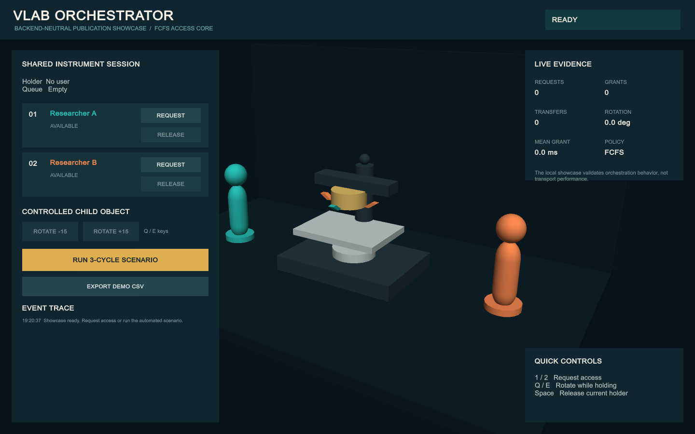

# VLab Orchestrator

VLab Orchestrator is a Unity research-software framework for applying one
session, shared-access, authority-transfer, synchronization, telemetry, and
evaluation model across heterogeneous multiplayer networking backends.

This repository is the rights-cleared research-software artifact prepared for
the VLab Orchestrator SoftwareX submission. It is intentionally separate from
the complete XR2Learn V-Lab development project and contains no original V-Lab
media or redistributed networking SDK source.



## Open the Rights-Cleared Showcase

The included showcase uses the real backend-independent FCFS queue core and
editable instrument and participant prefabs made entirely from Unity primitives.
It contains no original microscope, laboratory scene, avatar, texture, audio,
or third-party SDK payload. It can be used in two modes:

- **Dependency-free mode:** run the local deterministic FCFS demonstration.
- **Five-backend mode:** install the audited SDK matrix through the setup window;
  the project then materializes the project-authored adapters and network-ready
  generic prefabs automatically.

1. Install Unity `6000.3.11f1`.
2. In Unity Hub, select **Add project from disk**.
3. Select `repo/src/showcase/UnityProject`.
4. Open `Assets/Scenes/Showcase.unity`.
5. Open **VLab Orchestrator > Setup** to inspect or install the networking matrix.
6. Adjust the scene, materials, or prefabs if desired.
7. Press Play.
8. Request and release the instrument as Researcher A or Researcher B, rotate
   the controlled turret, or run the deterministic three-cycle scenario.
9. Use **Export Demo CSV** to create a small reproducible result file.

This dependency-free mode is the quickest installation check. It does not show
the multiplayer Create/Join interface because no production adapter runtime has
been generated yet.

Editable assets:

- `Assets/VLabOrchestrator/Prefabs/GenericSharedInstrument.prefab`
- `Assets/VLabOrchestrator/Prefabs/GenericResearcherAvatar.prefab`
- `Assets/VLabOrchestrator/Materials`

The Unity menu **VLab Orchestrator > Rebuild Editable Showcase Scene** restores
the known-good sample. It overwrites the showcase scene and generated prefab
assets, so use it as a reset command rather than after intentional customization.

The showcase demonstrates:

- Real FCFS request, queue, grant, and release decisions
- Two simulated participants
- Holder-only manipulation of a shared instrument
- Deterministic authority handoffs
- Controlled child-object rotation
- Live request, grant, transfer, and rotation metrics
- Human-readable event history
- CSV result export

The local demo does not simulate transport or claim backend-performance
equivalence. Paper results must be produced in five-backend mode using two
standalone clients and the fixed benchmark protocol.

## Activate The Five-Backend Runtime

The production runtime requires the complete audited SDK matrix. Partial SDK
installation deliberately leaves the project in the dependency-free showcase
mode so cross-backend source is never generated against missing dependencies.

| Backend | Audited version | Additional evaluator requirement |
|---|---:|---|
| Photon PUN 2 | 2.55 | Photon Realtime App ID |
| Photon Fusion | 2.0.9 build 1566 | Photon account/download and Fusion App ID |
| Unity Netcode for GameObjects | 2.11.0 | Installed from Unity Package Manager |
| FishNet | 4.6.22 | Official Asset Store package |
| Mirror | 96.0.1 | Official Asset Store package |

1. Open **VLab Orchestrator > Setup** and install the exact SDK shown in each
   backend tab. The lifecycle is designed to tolerate different installation
   orders; the documented sequence is the audited recommendation. Wait for
   Unity to finish importing and compiling before starting the next SDK.
2. When PUN 2 invokes Unity's API Updater for Unity 6 compatibility, approve
   updating **all affected files**. In dialogs that offer a project-wide option,
   select **Yes, for these and other files that might be found** (wording varies
   slightly by Unity patch version). These are provider-source API migrations in
   the local ignored SDK folder, not changes to the committed framework.
3. For PUN 2 and Fusion, create separate applications in the Photon dashboard
   and enter your own App IDs. Never commit those settings assets.
4. Confirm every backend card is green. The project then materializes the
   ignored production runtime and network-ready generic prefabs automatically.
5. Run **VLab Orchestrator > Validate Five-Backend Runtime**.
6. Select the backend and benchmark preset in the project configuration, then
   produce a non-development Windows build.
7. Run two standalone clients, create/join the same session, begin the session,
   and start the deterministic benchmark from the host.

Use **Safely Uninstall SDK** in a backend tab when testing clean installation.
Do not manually delete an SDK while generated runtime source is active. The safe
operation preserves configuration and exports, removes stale defines, and allows
the SDK to be installed again through the setup window.

Provider SDKs and Photon credentials cannot legally or securely be bundled in
this repository. The setup window verifies the pinned versions and uses packages
obtained through each evaluator's official provider account. Full details and
troubleshooting are in
[`docs/installation/BACKENDS.md`](docs/installation/BACKENDS.md).

## Validation And Tests

For the dependency-free artifact:

1. Open **Window > General > Test Runner** and run the EditMode tests.
2. Run **VLab Orchestrator > Validate Showcase**.
3. Run **VLab Orchestrator > Build Windows Showcase**. The executable is written
   to the ignored `Builds/` directory.
4. Confirm that the build opens the deterministic standalone FCFS interface.

For the multiplayer artifact, first confirm all five setup cards are green,
then run **VLab Orchestrator > Validate Five-Backend Runtime**. A passing result
checks the SDK matrix, materialized adapters, generated configuration, runtime
roots, generic network prefabs, and controlled-child contract. It does not
replace a two-client session test. The selected-backend Windows build must show
the Create/Join interface; seeing only the standalone interface means runtime
activation is incomplete.

When reporting a problem, include the Git commit, Unity version, selected
backend, exact SDK versions, installation order, first compiler/build error, and
whether every setup card was green. Do not include Photon App IDs or provider
account details.

## Repository Layout

```text
repo/src/
|-- framework/           Project-authored orchestration source snapshot
|-- packages/            Installable UPM core and five backend boundaries
|-- showcase/            Dependency-free playable Unity project
`-- backend-adapters/    Adapter source grouped by optional networking SDK

docs/
|-- architecture/
|-- installation/
`-- publication/

tests/                   Publication test specifications
```

SoftwareX requires the project source beneath `repo/src`; this repository keeps
that boundary explicit.

## Package Architecture

The showcase consumes the framework through Unity Package Manager rather than
duplicating orchestration code under `Assets`. The package graph contains:

- `com.vlab.orchestrator.core`, which compiles without a networking SDK
- `com.vlab.orchestrator.backend.pun2`
- `com.vlab.orchestrator.backend.fusion`
- `com.vlab.orchestrator.backend.netcode`
- `com.vlab.orchestrator.backend.fishnet`
- `com.vlab.orchestrator.backend.mirror`

The core package contains the FCFS queue, state models, configuration asset,
benchmark settings, setup window, SDK compatibility checks, and reproducible
runtime installer. The five package boundaries retain inspectable `.cs.txt`
copies, while authoritative project-authored source is stored under
`repo/src/framework` and `repo/src/backend-adapters`. Once all audited SDKs are
present, that source is copied to the ignored
`Assets/GeneratedSoftwareXRuntime` workspace and compiled together. Generated
network prefabs and the production configuration are likewise ignored and can
be recreated at any time with **VLab Orchestrator > Finalize SoftwareX Runtime**.

See
[`docs/architecture/PACKAGE_ARCHITECTURE.md`](docs/architecture/PACKAGE_ARCHITECTURE.md)
for the dependency and promotion model.

## Supported Production Backends

The complete integration currently supports:

- Photon PUN 2
- Photon Fusion
- Unity Netcode for GameObjects
- FishNet
- Mirror

Third-party SDK source is not redistributed here. Each backend adapter is
project-authored source and requires the corresponding official SDK before it
can be compiled and exercised. See
[`docs/installation/BACKENDS.md`](docs/installation/BACKENDS.md).

The tracked generic prefabs are visual and semantic sources, not vendor network
identities. Five-backend activation creates ignored backend-authored copies while
preserving the same stable object and controlled-child contracts.
See [`docs/architecture/PREFAB_CONTRACTS.md`](docs/architecture/PREFAB_CONTRACTS.md).

## Current Status

| Area | Status |
|---|---|
| Dependency-free playable showcase | Included |
| Editable generic scene and prefabs | Included |
| Installable SDK-independent core package | Included and tested |
| Unity research workspace and configuration asset | Included |
| Five optional backend package boundaries | Included |
| Five adapter source implementations | Included for inspection |
| Generic rights-cleared instrument | Editable Unity prefab |
| Original V-Lab case study | Maintained in the private development project |
| Executable five-backend runtime | Reproducibly materialized after SDK installation |
| Core Unity edit-mode tests | Included |
| Five-backend cold-start validation | Included and passing locally |
| Windows publication build | Produced by repository build command |
| Public open-source license | MIT License |
| Public GitHub repository | Prepared; visibility and archival release pending |

## Publication Boundary

The original V-Lab scene remains an important case study, but it is not required
to understand or run this repository. This separation avoids redistributing
models, media, vendor packages, credentials, or unrelated application code.

The public release will contain only project-authored framework code,
rights-cleared samples, tests, documentation, and protocol definitions.

## Reproducibility Notes

- Open the project with Unity `6000.3.11f1`; changing Unity or SDK versions
  creates a new experimental environment and must be reported separately.
- Use non-development Windows players for reported runtime measurements.
- Use two standalone executables for final measurements. Editor-player runs are
  useful for debugging but are not interchangeable with the reported protocol.
- Accept only exports labelled valid by the terminal scenario assertions. Keep
  invalid exports for diagnosis rather than silently including them in analysis.
- Record backend, scenario, protocol version, machine specifications, transport,
  client topology, and repetition identifier for every reported run.

## Documentation

- [Architecture](docs/architecture/OVERVIEW.md)
- [Unity package architecture](docs/architecture/PACKAGE_ARCHITECTURE.md)
- [Prefab and synchronization contracts](docs/architecture/PREFAB_CONTRACTS.md)
- [Backend installation boundaries](docs/installation/BACKENDS.md)
- [SoftwareX submission plan](docs/publication/SOFTWAREX_SUBMISSION_PLAN.md)
- [Research protocol](docs/publication/BENCHMARK_PROTOCOL_AND_REPRODUCIBILITY.md)
- [Asset provenance](ASSET_PROVENANCE.md)
- [Third-party notices](THIRD_PARTY_NOTICES.md)

## License

Project-authored code is released under the MIT License. Copyright is held by
Nikolaos Marmaras, with institutional affiliation to the Hellenic Open
University recorded in the license and publication metadata. Vendor SDKs are
not covered by the project license and remain excluded from version control.
