# Illustrated Installation And Evaluation Guide

This guide provides the shortest reproducible route from a clean clone to a
two-client VLab Orchestrator benchmark. Yellow boxes in the screenshots identify
the control or state relevant to each step. Screenshots are illustrative; the
exact window layout may vary with monitor size.

## 1. Open The Correct Unity Project

Install Unity `6000.3.11f1`. In Unity Hub, choose **Add > Add project from
disk**, then select:

```text
VLab-Orchestrator/repo/src/showcase/UnityProject
```

Do not select the repository root or create a new Unity project.

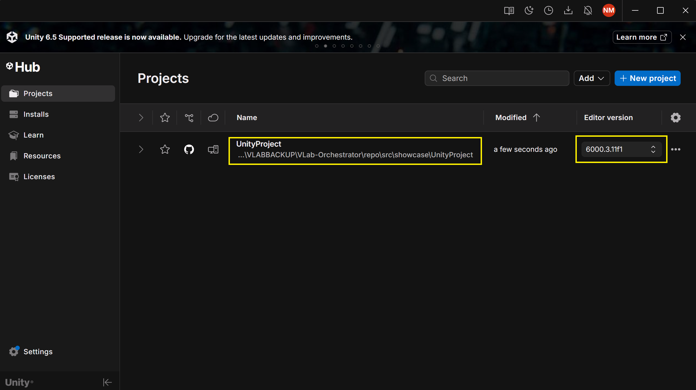

Wait until Package Manager resolution, asset import, and script compilation have
all finished. A clean first import can take several minutes. Do not install an
SDK while Unity is still compiling.

## 2. Open The Showcase Scene

In the Project panel, open `Assets/Scenes/Showcase.unity`.

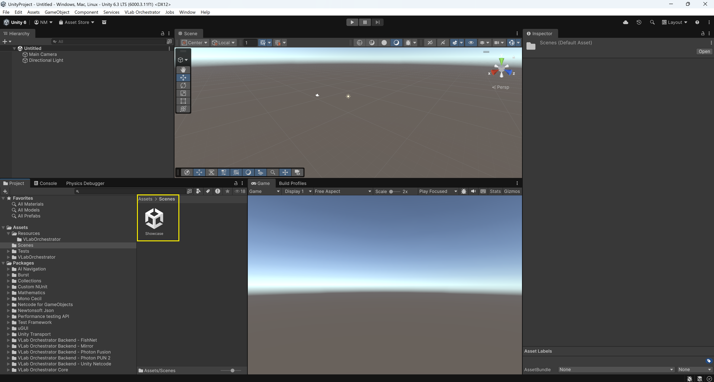

The scene should show the generic instrument and two primitive researcher
figures. These rights-cleared objects replace the private V-Lab media.

## 3. Open The Setup Workspace

Select **VLab Orchestrator > Setup**.

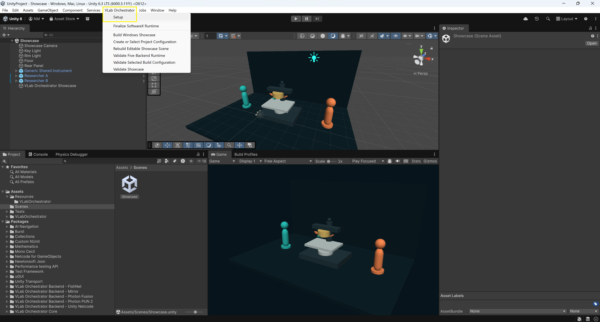

Each backend tab has one primary action. A red card identifies missing setup; a
green card marked **READY** confirms the audited SDK version, adapter,
compilation, and any required local credential.

## 4. Install Photon PUN 2

Open the **PUN 2** tab and select **Install Photon PUN 2**.

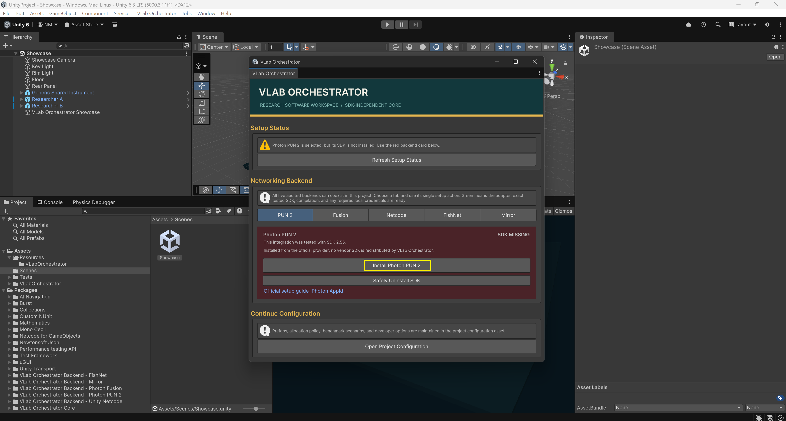

The setup action imports only the audited PUN 2 `2.55` package obtained through
the evaluator's official Unity Asset Store account. The repository does not
redistribute this SDK.

### Required Unity 6 API Update

PUN 2 may trigger Unity's **Script Updating Consent** dialog because provider
scripts reference APIs changed by Unity 6. Select:

**Yes, for these and other files that might be found later**

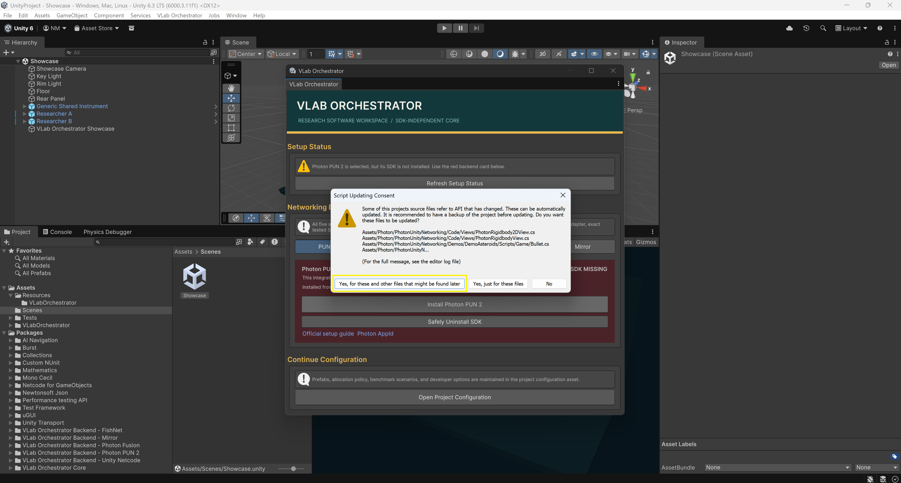

Do not select **No**. The updater changes only the locally imported, Git-ignored
PUN SDK source. Wait for the resulting import and compilation to finish.

### Configure The PUN App ID

Create a Photon Realtime application in the evaluator's Photon dashboard. In
the PUN Wizard, enter its App ID and select **Setup Project**. An account email
can open the provider workflow, but the final project requires the App ID.

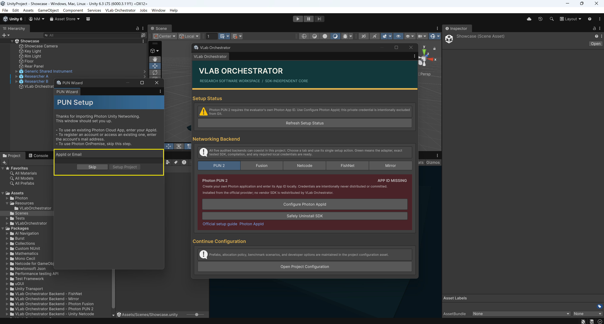

Use a private evaluator-owned ID. Never publish it, paste it into an issue, or
commit `PhotonServerSettings.asset`.

## 5. Install Photon Fusion

Open the **Fusion** tab and follow its install action. Fusion requires a Photon
account to obtain the audited Fusion `2.0.9 build 1566` package. Do not substitute
Fusion `2.1.x`, because it has not passed this five-backend compatibility matrix.

Create a separate **Fusion 2** application in the Photon dashboard and paste its
App ID into **Fusion 2 Hub > Fusion 2 Setup**.

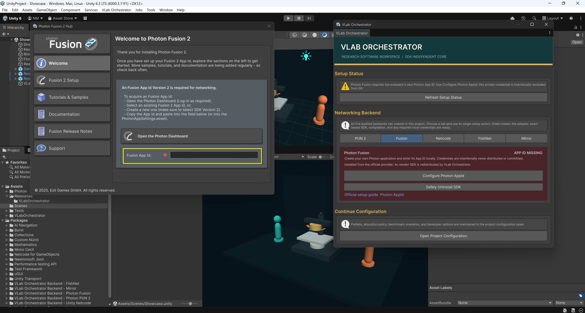

PUN and Fusion must use separate applications of the correct Photon type. Their
settings remain local and are ignored by Git.

## 6. Confirm Unity Netcode

Netcode for GameObjects `2.11.0` is pinned in the showcase package manifest and
normally resolves during the first project import. Open the **Netcode** tab and
confirm that its card is green and marked **READY**.

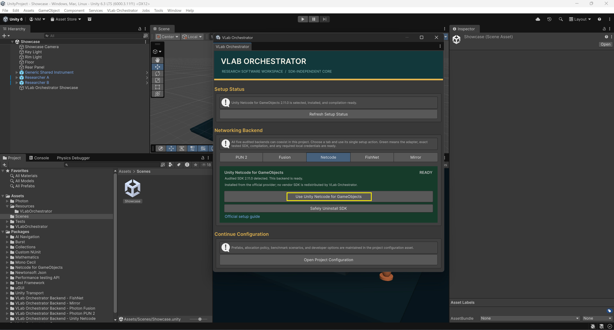

If it is not ready, wait for Package Manager and compilation, then select the
tab's primary action. Do not install a different Netcode version manually.

## 7. Install FishNet And Mirror

Open the **FishNet** tab and install the audited FishNet `4.6.22` package.

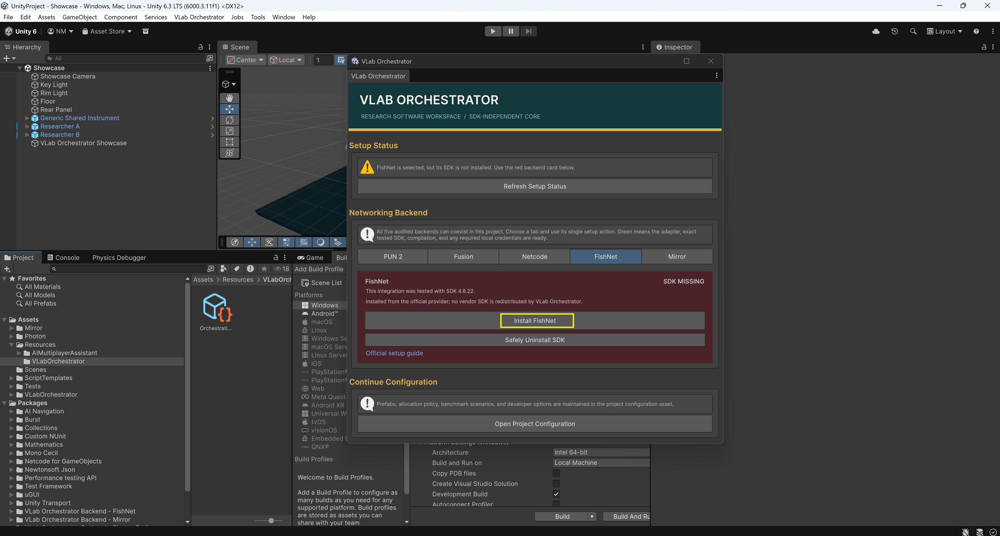

Then open the **Mirror** tab and install Mirror `96.0.1`. Wait for Unity to
finish compiling after each import. The setup postprocessor handles the audited
FishNet/Mirror migration-tool compatibility automatically.

If testing installation order or recovery, use **Safely Uninstall SDK**. Do not
remove an imported SDK manually while generated runtime source is active.

## 8. Confirm Full Runtime Activation

Revisit every backend tab. Continue only when all five cards are green and show
**READY**. Unity then generates the ignored production runtime automatically.

Run **VLab Orchestrator > Validate Five-Backend Runtime**. The Console must
report that validation passed. If the Windows player later shows only the
standalone FCFS interface, full runtime activation did not complete: return to
Setup, check all five cards, and run validation again.

## 9. Select Backend And Benchmark

Select **Open Project Configuration** in Setup. In the Inspector:

1. Choose the backend to evaluate.
2. Keep **Auto Bootstrap On Scene Load** and **Create Telemetry** enabled.
3. Enable **Automated Benchmark** and **Auto Export On Complete**.
4. Enable **Use Canonical Paper Preset**.
5. Select one benchmark scenario.

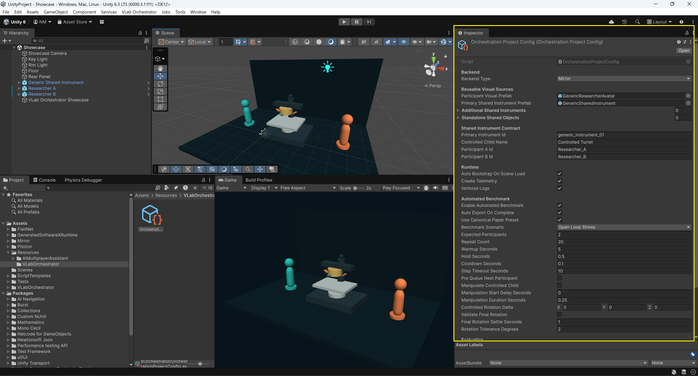

When the canonical preset is enabled, do not manually alter cycle counts,
timings, rotations, tolerances, or expected participants. Change only the
backend and scenario between comparable runs.

## 10. Build A Windows Player

Run **VLab Orchestrator > Validate Selected Build Configuration**, then use
**VLab Orchestrator > Build Windows Showcase**. Unity's standard **File > Build
Profiles** route is also shown below.

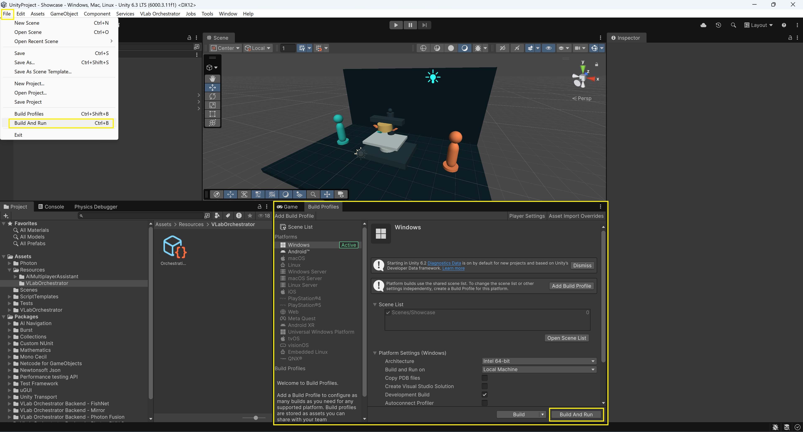

**Important:** the screenshot illustrates the control location, but final paper
measurements must have **Development Build**, **Autoconnect Profiler**, and
**Deep Profiling** disabled. Development players are for debugging only.

Open the generated `VLab Orchestrator Showcase.exe`.

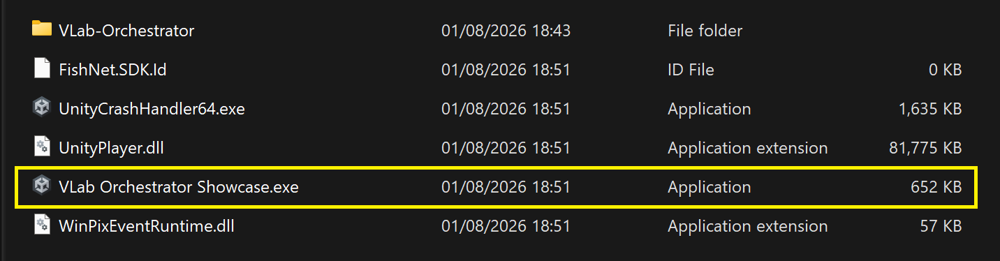

## 11. Create A Two-Client Session

For final measurements, launch the same non-development executable twice. Do
not use an Editor-plus-player pair for reported results.

1. Enter a different participant name in each client and select **Apply name**.
2. Enter exactly the same room name in both clients.
3. On client 1, select **Create**.
4. On client 2, select **Join**.
5. Confirm both participant names appear in both clients.
6. On the host, select **Begin session**.
7. Confirm both clients show the shared instrument and both avatars.
8. Start **Run configured benchmark** from the host only.

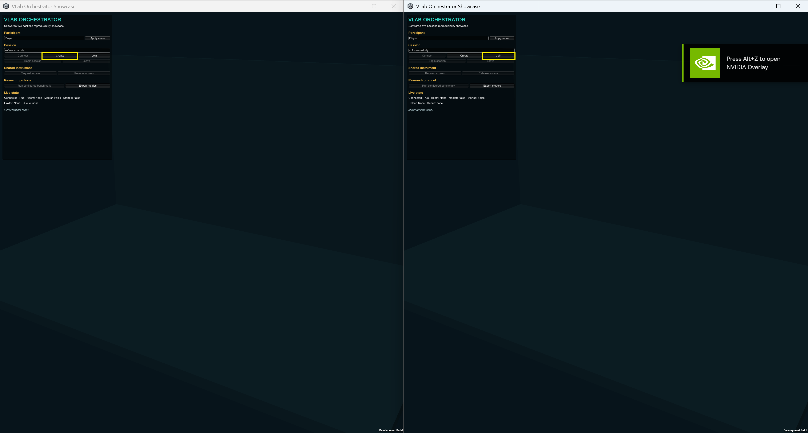

## 12. Accept Or Reject The Export

Do not close either client until the host reports one of these terminal states:

- **VALID EXPORT SAVED - SAFE TO QUIT**: retain the run.
- **INVALID RUN EXPORTED - SAFE TO QUIT - DO NOT USE**: preserve it for
  diagnosis, but exclude it from comparative analysis.

The second client may report that its steps are complete while waiting for the
host export. This is expected. The host message prints the exact export folder.
Each retained run must contain `run_master_summary.csv`, `run_metadata.csv`,
`scenario_assertions.csv`, scenario/authority events, queue/fairness summaries,
and runtime performance files.

## Evaluator Checklist

- [ ] Unity `6000.3.11f1` used
- [ ] Showcase scene opened without compiler errors
- [ ] PUN 2 Unity 6 API update approved for all files
- [ ] Separate evaluator-owned PUN and Fusion App IDs configured locally
- [ ] PUN 2 `2.55`, Fusion `2.0.9 build 1566`, Netcode `2.11.0`, FishNet
      `4.6.22`, and Mirror `96.0.1` detected
- [ ] All five Setup cards green
- [ ] Five-backend runtime validation passed
- [ ] Canonical paper preset enabled
- [ ] Non-development Windows player built
- [ ] Two standalone clients used
- [ ] Both users, avatars, and shared instrument visible
- [ ] Benchmark started from host only
- [ ] Terminal export status read before quitting
- [ ] Only valid exports used for comparison
