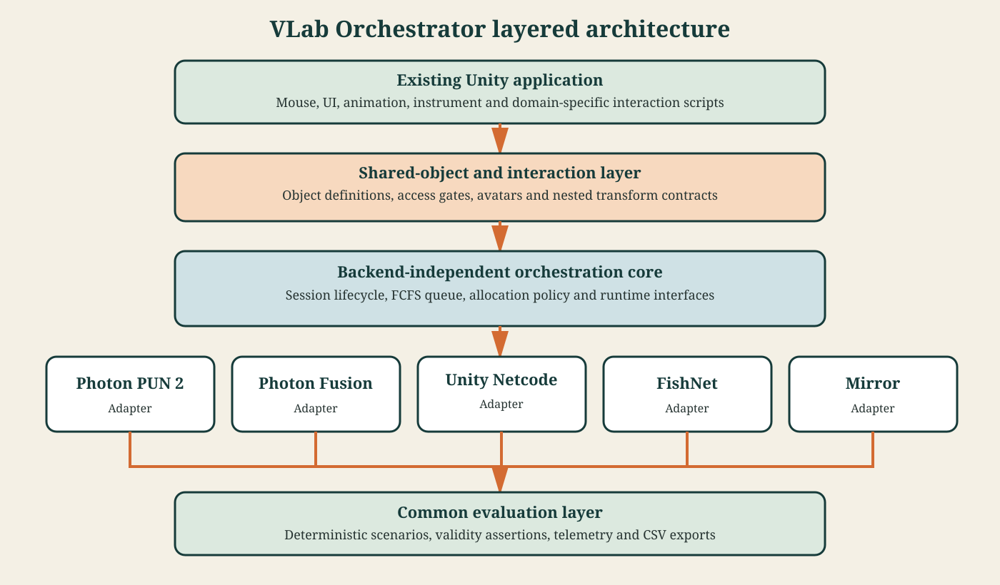
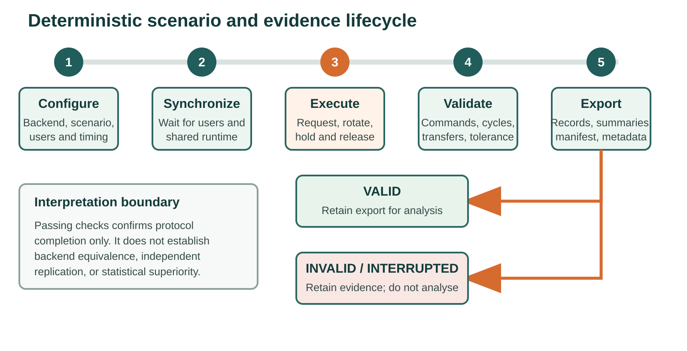

# VLab Orchestrator: A multi-backend orchestration and controlled evaluation framework for Unity virtual laboratories

> SoftwareX manuscript draft, 23 July 2026. Text in square brackets requires author confirmation before submission.

## Authors

Nikolaos Marmaras^[Hellenic Open University; ORCID pending]

Dimitris Kalles^[Hellenic Open University; https://orcid.org/0000-0003-0364-5966]

[CO-AUTHORS, AFFILIATIONS, AND ORCIDS]

Corresponding author: [EMAIL]

## Abstract

VLab Orchestrator is a Unity framework intended to reduce direct coupling between virtual-laboratory interaction logic and a selected networking software development kit. It provides common session, access-allocation, authority-transfer, shared-object, avatar, telemetry, and deterministic-scenario services through adapters for Photon PUN 2, Photon Fusion, Unity Netcode for GameObjects, FishNet, and Mirror. A demonstration project built from Unity primitives and a common export schema support controlled cross-backend execution. Five two-user scenarios were completed in 25 Windows-to-Windows runs that passed predefined protocol checks. The software is designed to retain domain interaction scripts while exposing networking choices through an explicitly documented evaluation protocol.

**Keywords:** virtual laboratories; Unity; multiplayer; networking; orchestration; controlled benchmarking

## Code metadata

| Item | Description |
|---|---|
| C1 Current code version | 1.0.0; archival DOI pending |
| C2 Permanent repository link | https://github.com/Nikolhs123/VLab-Orchestrator |
| C3 Code license | MIT License |
| C4 Version-control system | Git |
| C5 Languages, tools, and services | C#, Unity 6000.3.11f1, Unity Package Manager, CSV |
| C6 Requirements | Unity 6000.3.11f1; Windows 11 validated; selected third-party networking SDK and credentials where required |
| C7 Documentation | Repository README and `docs/` directory |
| C8 Support email | [SUPPORT EMAIL] |

## 1. Motivation and significance

Reviews describe virtual laboratories as software-based or remotely accessible alternatives used in science, technology, and engineering education, with reported advantages that include flexible access and repeatable simulation. The same literature cautions that educational outcomes depend on instructional design and that virtual laboratories do not automatically replace physical practice [1]. In collaborative implementations, room lifecycle, user identity, shared-object discovery, exclusive access, queued requests, network authority, state convergence, and comparative evaluation become additional software concerns. A Unity laboratory may already contain mouse, keyboard, user-interface, animation, and instrument-control scripts. Coupling those scripts directly to one networking application programming interface (API) can increase the effort required to maintain the application or evaluate another networking technology.

Networking libraries also expose different abstractions. Their concepts of host, server, master client, ownership, state authority, remote procedure calls, scene objects, prefabs, and connection identifiers are not directly interchangeable. Consequently, a comparison based on independently written demonstrations can confound the networking backend with differences in application logic, timing, test execution, and instrumentation. Manual transfer tests add further operator-dependent variation.

VLab Orchestrator addresses this engineering and methodological problem with an orchestration layer placed above the existing application scripts. The intended division is that the application controls what an instrument does, while the framework controls who may interact, how a session progresses, how authority is requested or released, and how corresponding events are recorded. Backend-specific code is isolated behind runtime contracts and authoring utilities. Adapters have been implemented for Photon PUN 2, Photon Fusion, Unity Netcode for GameObjects, FishNet, and Mirror.

Related software demonstrates the value of reusable Unity research components and collaborative immersive applications. UnityGeoAR packages geolocation, reprojection, and augmented-reality alignment behind a minimal Unity API [2]. ABMU provides a Unity framework for three-dimensional agent-based modelling [3]. XR4MCR is a multi-user Unity-based mixed-reality platform for collaborative robot-maintenance training and synchronized procedures [4]. Earlier work described a component framework for adding collaboration, session handling, avatars, and shared scene state above an existing virtual-reality application [5], while a reference architecture for scientific virtual laboratories identified cooperation and distributed information management as architectural concerns [6]. MAGES 4.0 is a medical VR/AR authoring SDK layered on game engines that supports collaborative, networked training applications [7]. These systems establish relevant precedents, but their stated contributions concern geospatial AR, modelling, domain-specific collaborative training, or a single collaboration architecture. Within this reviewed set, we did not identify software reporting the same combination of five Unity networking adapters, deterministic authority-allocation scenarios, backend-neutral telemetry, and a common analysis workflow. The application context was informed by V-Lab, a modular virtual-laboratory framework developed as an XR2Learn beacon application at the Hellenic Open University [15].

| Software | Reusable Unity component | Multi-user collaboration | Multiple networking backends | Deterministic allocation benchmark | Common cross-backend export |
|---|---:|---:|---:|---:|---:|
| UnityGeoAR [2] | Yes | No | No | No | No |
| ABMU [3] | Yes | No | No | No | No |
| XR4MCR [4] | Application platform | Yes | Not its stated contribution | No | No |
| Collaborative VR framework [5] | Framework | Yes | No | No | No |
| MAGES 4.0 [7] | SDK for Unity/Unreal | Yes | No | No | No |
| VLab Orchestrator | Yes | Yes | Five | Yes | Yes |

The table compares stated software scope rather than implementation quality. A blank capability is not a deficiency when it lies outside a cited project's purpose.

The contribution is therefore not another networking protocol and not a claim that one backend is universally superior. It is research software designed to (i) separate collaborative policy from laboratory behaviour, (ii) express a common session and allocation model across heterogeneous SDKs, and (iii) provide the records needed for controlled, auditable comparisons. This distinction matters because backend performance depends on topology, transport, geographic distance, traffic, platform, SDK settings, and workload. VLab Orchestrator records protocol and environment metadata so that reported observations can be bounded to the experiment that produced them.

## 2. Software description

### 2.1 Architecture

The software is distributed as a core Unity package, optional backend adapter packages, a rights-cleared showcase project, documentation, and evaluation data. The core package contains no laboratory-specific model requirement. The showcase uses Unity primitives so that installation, execution, and review do not depend on restricted media from the original laboratory.

**Fig. 1.** Intended separation of application behaviour, shared orchestration contracts, backend adapters, and the common telemetry layer.

Three interfaces define the common runtime boundary. `IOrchestrationBackendRuntime` exposes backend lifecycle and runtime capabilities. `IOrchestrationSessionView` provides backend-neutral session state to the user interface and telemetry. `IOrchestrationQueueView` exposes access-holder and waiting-user state. Runtime resolution selects the adapter configured in `OrchestrationProjectConfig`; application and telemetry code consume the interfaces rather than SDK classes.

Each adapter translates common actions into native backend operations using the documented lifecycle, authority, and synchronization facilities of PUN 2, Fusion, Unity Netcode for GameObjects, FishNet, and Mirror [10-14]. It handles connection and room lifecycle, spawns or locates the backend's queue authority, maps local users to framework identifiers, and forwards state changes to common observers. Backend-specific network behaviours implement authority transfer and synchronized transforms while shared definitions describe which scene objects and child transforms participate. The package structure confines direct SDK references to adapter code, while authoring utilities remove components associated with a previously selected backend from shared prefabs.

The editor setup window is the principal installation and configuration surface. Backend tabs show dependency status and guide SDK-specific setup. A backend is considered ready only when its package, adapter, runtime components, and required configuration are available. The authoring pipeline configures shared avatar and instrument prefabs for the selected backend. Runtime bootstrap code can provision managers and orchestration services, allowing the showcase scene to remain independent of manually placed backend manager objects.

### 2.2 Session and allocation model

The common session model covers disconnected, lobby, room, and active-session states. A host creates a named room, clients join it, and the host begins the shared session. Display names are entered through the common telemetry interface and synchronized on user cards and avatar labels.

Shared instruments use an explicit access gate. A user requests access; the authoritative queue evaluates the request according to the configured policy. Under the evaluated first-come, first-served configuration, a free instrument grants access immediately, while later requests are queued. Release grants the instrument to the next eligible user. The runtime interfaces expose the current holder, queue order, decisions, and timestamps to each adapter. The framework can also be configured to trigger release after inactivity.

Access and networking authority are related but separate. The policy decides which user should control an object; the adapter performs the backend-native authority transition. This separation avoids embedding a research policy in SDK callbacks and permits equivalent policies to be evaluated across implementations. Existing object scripts may check the shared gate before applying input, but they do not need to implement networking queues themselves.

### 2.3 Shared objects and user presence

`SharedSyncObjectDefinition` describes a shared root, instrument-equivalent children, standalone objects, and synchronized properties. Objects may already exist in a scene or may be instantiated from configured prefabs at runtime. The provisioner checks for an existing configured object before instantiation, reducing unintended duplication during the tested setup.

A shared avatar prefab is adapted automatically for the chosen backend. Common scripts manage user identity and labels, while backend-specific presence and transform components handle spawning and synchronization. Single-player sessions can use the same avatar representation without starting a network backend. This arrangement provides one editable visual prefab rather than maintaining five divergent copies.

Child-object synchronization supports instruments whose operation is expressed by local rotations or positions below a shared root. Authority-aware sender logic is intended to accept changes from the current holder and propagate them through the selected backend. The showcase uses a rotating turret as a neutral substitute for the original microscope nosepiece; the benchmark therefore exercises the same type of nested transform without distributing restricted laboratory media.

### 2.4 Telemetry and deterministic evaluation

The telemetry subsystem records session lifecycle, queue decisions, access requests, releases, authority transfers, child-transform commands, convergence, runtime performance, and validity assertions. Exports use a backend-neutral directory and CSV schema. Staging and completion markers distinguish completed exports from files left by interrupted export operations.

`OrchestrationScenarioRunner` replaces manual timing with deterministic commands. Scenarios specify participant count, cycles, hold durations, contention pattern, and target manipulation. The authoritative runner waits for both users, executes the same logical sequence, checks acknowledgements and convergence, releases final ownership, and exports only after terminal assertions have been evaluated. A visible completion state distinguishes valid exports from runs that are safe to inspect but unsuitable for analysis.

**Fig. 2.** Implemented benchmark workflow and its terminal classification according to predefined protocol checks.

The editor research workspace discovers exports, checks protocol completeness, and summarizes comparable measures. These include authority-transfer latency, queue wait, grant/release counts, transform error, frame timing, and failed assertions. Raw records remain available so aggregate results can be audited or reanalysed in external statistical software.

The repository follows the general principle that a research artifact should be documented, complete, executable, and accompanied by verification evidence [8]. It records source, protocol, configuration, raw observations, summaries, and environment metadata as separate artifacts. The retained raw and derived files allow readers to distinguish software verification, repeated execution, and independent replication; no independent replication is claimed in this article.

## 3. Illustrative examples

The included showcase illustrates the implemented workflow. A researcher opens the Unity project, selects `VLab Orchestrator > Setup`, chooses a backend, resolves its documented dependencies, and applies the configuration. Two built Windows players are launched on one machine for the evaluated protocol. One creates a room and the second joins it. After both users appear, the host starts the session and runs a selected scenario. The runner alternates access and rotates the nested turret, then writes a self-contained export.

**Fig. 3.** The public showcase uses editable Unity primitives for the shared instrument and participant representations and exercises the orchestration workflow without redistributing the original laboratory scene or media.

Five scenarios exercise distinct orchestration properties:

| Scenario | Purpose |
|---|---|
| S1 Baseline FCFS | Three alternating first-come, first-served cycles, 10 s holds, and 60-degree turret commands |
| S2 Contention Burst | Five cycles in which both users request access before release, producing a queued request; 5 s holds; 30-degree turret commands |
| S3 Rapid Handoff | Ten rapid authority-handoff cycles, each using a 2.5 s hold before release; 15-degree turret commands |
| S4 Transform Replication | Five cycles emphasizing remote convergence of the commanded child rotation; 8 s holds; 90-degree turret commands |
| S5 Open-Loop Stress | Twenty 0.5 s authority cycles without closed-loop turret convergence |

The candidate dataset contains 25 Windows-to-Windows runs: five scenarios for each of five backends. Every run used two clients on the same Windows 11 workstation, Unity 6000.3.11f1, and the same showcase, while cycle count, ownership interval, and target rotation followed the selected scenario in Table 2. All 25 exports passed the framework's predefined structural checks: two expected users were present, the scenario-specific cycles completed, and no failed validity assertions, commands, or authority transfers were recorded. These are internal protocol checks rather than external certification of behavioural equivalence.

Targeted protocol-1.5 reruns were used to investigate anomalies rather than to expand the balanced matrix. After correction of abandoned Unity Netcode authority-transfer timestamps, the targeted runs produced mean values of 12.70 ms in S1, 15.25 ms in S3, and 14.33 ms in S4, with recorded observations between 0 and 18.60 ms. A Mirror S1 angular miss of 84.58 degrees in the candidate run did not reproduce in the targeted rerun, which completed with zero terminal angular error. A PUN 2 S3 error did reproduce: 3.33 degrees in the candidate run and 2.76 degrees in validation, exceeding the configured 2-degree tolerance while all commands and transfers completed. It is therefore reported as a backend/workload convergence observation, not silently removed.

These data show that the common protocol completed across the evaluated backend-scenario combinations and recorded outcomes that could be inspected when anomalies occurred. They are not sufficient for population-level claims about backend performance: each balanced cell currently represents one independent same-machine session, and the targeted reruns are diagnostic rather than balanced replicates. The repository consequently publishes raw exports, environment details, protocol versions, and validation rationale alongside summaries. This follows benchmark guidance that comparisons must define their tasks, data-generating conditions, outcomes, and uncertainty rather than treating a single score as an intrinsic property of a method [9].

## 4. Impact

VLab Orchestrator is designed to reduce coupling between collaborative research applications and networking SDKs. In the audited V-Lab case study, existing interaction scripts and models were retained while a common session interface, allocation gate, shared-object definition, and selected adapter were added. Changing backend still requires the SDK and its legal configuration, but the common research policy and evaluation protocol are represented outside the adapter. This separation may be useful for long-lived educational software, where service availability, licensing, deployment topology, and institutional constraints may change.

The software is intended to improve experimental consistency. Common high-level commands, explicit validity assertions, clean terminal release, and one export schema reduce some sources of operator timing and instrumentation variation, although they do not remove backend-specific or system-level confounders. Failed runs remain visible and are labelled unusable instead of entering an analysis unnoticed. Protocol versions and machine characteristics make corrections traceable, as illustrated by the separation of the candidate matrix from anomaly-validation reruns.

The framework is intended for three audiences. Virtual-laboratory developers can use it to add controlled collaboration above domain scripts. Networking researchers can use the common workload to design comparative studies. Educators and human-computer-interaction researchers can adapt allocation policies or interaction tasks while retaining session and telemetry infrastructure. The architecture also contains optional policy interfaces that could host future decision modules, including remote artificial-intelligence services. No AI component is evaluated or claimed in the present release; deterministic FCFS allocation is the evaluated baseline.

The current evaluation has limitations. Tests were conducted on one workstation with two Windows players, no induced network impairment, and a nominal 120 frames-per-second cap. The machine used Windows 11 Pro, an Intel Core Ultra 7 265K processor, 31.37 GiB RAM, an NVIDIA RTX 4080 SUPER, and an SSD. Same-machine measurements avoid variation from an external network path but do not represent local-area or internet deployment. The balanced matrix has one independent run per backend-scenario cell, so performance values are descriptive. Future experiments should use repeated independent sessions, randomized backend order, machine restarts or controlled cool-down periods, a wired multi-machine local-area-network condition, and reproducible latency/loss profiles. Confidence intervals and effect sizes should then be reported for predeclared primary outcomes.

Third-party SDKs are not redistributed where their licences or account processes prohibit it. Photon services require application identifiers, and package versions may impose Unity module dependencies. The setup interface detects and documents these requirements, but external SDK availability remains outside the project's control. Only Windows and the specified Unity version have been validated in the current release.

## 5. Conclusions

VLab Orchestrator implements a common orchestration and evaluation layer for five Unity multiplayer backends. Its architecture separates application behaviour, allocation policy, and backend authority mechanics; provisions shared objects and avatars; and executes deterministic scenarios with validity-aware exports. A showcase built from Unity primitives and the accompanying candidate and validation datasets make the reported implementation inspectable without the original laboratory assets. The present evidence supports successful protocol completion for the 25 evaluated backend-scenario combinations and illustrates how anomalous measurements were retained and investigated. It does not establish behavioural equivalence or comparative superiority. Such conclusions require balanced independent repetitions, network-condition experiments, and uncertainty analysis.

## Acknowledgements

The authors acknowledge the Hellenic Open University V-Lab and XR2Learn teams, whose virtual-laboratory work provided application context and inspiration for the development of VLab Orchestrator [15].

## References

[1] V. Potkonjak, M. Gardner, V. Callaghan, P. Mattila, C. Guetl, V.M. Petrovic, K. Jovanovic, Virtual laboratories for education in science, technology, and engineering: A review, Computers & Education 95 (2016) 309-327. https://doi.org/10.1016/j.compedu.2016.02.002.

[2] K. Cheliotis, F. Liarokapis, M. Kokla, et al., UnityGeoAR: A geolocation Augmented Reality package for Unity3D, SoftwareX 27 (2024) 101774. https://doi.org/10.1016/j.softx.2024.101774.

[3] K. Cheliotis, ABMU: An Agent-Based Modelling Framework for Unity3D, SoftwareX 15 (2021) 100771. https://doi.org/10.1016/j.softx.2021.100771.

[4] Y.E. Esen, B.K. Cetincan, K. Yayan, O. Burnak, U. Yayan, XR4MCR: Multiplayer collaborative robotics maintenance training platform in extended reality, SoftwareX 31 (2025) 102348. https://doi.org/10.1016/j.softx.2025.102348.

[5] M. Ponder, G. Papagiannakis, T. Molet, N. Magnenat-Thalmann, D. Thalmann, Enhancing collaboration in virtual reality applications, Computers & Graphics 29 (5) (2005) 704-718. https://doi.org/10.1016/j.cag.2005.08.023.

[6] A. Voss, M. Freisleben, A reference architecture for scientific virtual laboratories, Future Generation Computer Systems 18 (3) (2002) 333-348. https://doi.org/10.1016/S0167-739X(01)00042-5.

[7] P. Zikas, A. Protopsaltis, N. Lydatakis, et al., MAGES 4.0: Accelerating the world's transition to VR training and democratizing the authoring of the medical metaverse, IEEE Computer Graphics and Applications 43 (2) (2023) 43-56. https://doi.org/10.1109/MCG.2023.3242686.

[8] Association for Computing Machinery, Artifact Review and Badging, ACM Publications, https://www.acm.org/publications/policies/artifact-review-and-badging-current, accessed 25 July 2026.

[9] L.M. Weber, W. Saelens, R. Cannoodt, C. Soneson, A. Hapfelmeier, P.P. Gardner, A.-L. Boulesteix, Y. Saeys, M.D. Robinson, Essential guidelines for computational method benchmarking, Genome Biology 20 (2019) 125. https://doi.org/10.1186/s13059-019-1738-8.

[10] Exit Games GmbH, Photon Unity Networking 2 documentation, https://doc.photonengine.com/pun/current/getting-started/pun-intro, accessed 25 July 2026.

[11] Exit Games GmbH, Photon Fusion 2 documentation, https://doc.photonengine.com/fusion/v2/fusion-intro, accessed 25 July 2026.

[12] Unity Technologies, Netcode for GameObjects, https://github.com/Unity-Technologies/com.unity.netcode.gameobjects, accessed 25 July 2026.

[13] FirstGearGames, FishNet documentation, https://fish-networking.gitbook.io/docs, accessed 25 July 2026.

[14] Mirror Networking, Mirror documentation, https://mirror-networking.gitbook.io/docs, accessed 25 July 2026.

[15] V. Zafeiropoulos, G. Anastassakis, T. Orphanoudakis, D. Kalles, A. Fanariotis, V.E. Fotopoulos, The V-Lab VR Educational Application Framework: A Beacon Application of the XR2Learn Project, in: MobileHCI '23 Companion, ACM, 2023, Article 32, 1-4. https://doi.org/10.1145/3565066.3608246.
