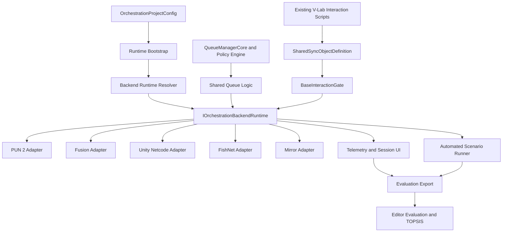

# Architecture

## System View

## Layers

### Existing Application Layer

The pre-existing V-Lab contains laboratory models and interaction scripts such
as `MouseUI`. These scripts retain responsibility for domain behavior, including
clicking, dragging, keyboard interaction, and application UI.

The orchestrator does not replace this layer. It discovers or receives the
objects to coordinate and controls whether a participant may manipulate them.

### Configuration and Bootstrap

`OrchestrationProjectConfig` is the central project asset. It selects:

- Networking backend
- Backend runtime root prefabs
- Shared avatar and UI assets
- Scene and runtime-provisioned shared objects
- Automated benchmark protocol
- Evaluation criteria and weights
- Optional AI mode and provider

`OrchestrationRuntimeBootstrapEntryPoint` loads the configuration from
`Resources`. `OrchestrationRuntimeBootstrap` then creates only the selected
backend's runtime infrastructure and shared services.

### Runtime Contracts

The runtime contracts separate consumers from networking SDK details:

- `IOrchestrationBackendRuntime` controls connection, room, and session actions.
- `IOrchestrationSessionView` exposes connection, room, master-client, and
  participant state.
- `IOrchestrationQueueView` exposes holder, waiting queue, access requests,
  releases, and shared user-card data.

`BackendRuntimeResolver` maps the selected configuration enum to the active
adapter.

### Core Allocation

`QueueManagerCore` is the backend-independent allocation engine. It manages
registered users and instruments, requests, releases, queue positions, and
timeouts.

`PolicyEngineCore` supplies the allocation policy. FCFS is the currently
evaluated policy. `QueueRuntimeSharedLogic` provides common runtime behavior,
including late join handling, disconnected-user cleanup, pending requests,
history, and policy hooks.

Backend queue runtimes transport and replicate the resulting state using each
SDK's networking model.

### Shared Synchronization

`SharedSyncObjectDefinition` describes one shared object and its controlled
children. `AutomaticBackendObjectBinding` applies the required backend
components. `BaseInteractionGate` and
`BaseMicroscopeAccessController` enforce access while preserving the object's
existing application behavior.

`ConfiguredSharedObjectRuntimeProvisioner` supports both:

- An object that already exists in the scene
- A configured prefab that should be spawned when no scene equivalent exists

Backend-specific synchronization scripts implement authority and state
replication while sharing the same object definition and access rules.

### User Presence

The shared avatar is adapted for the selected backend. Backend implementations
handle:

- Network spawning
- Local and remote transform synchronization
- Display-name synchronization
- Local ownership and visibility behavior

The same display-name input and shared avatar concept are exposed across all
five backends.

### Telemetry and Evaluation

Telemetry observes the common runtime views and backend-specific transfer
events. The framework records:

- Session lifecycle
- Queue requests and transitions
- Authority transfers
- User and instrument statistics
- Fairness
- Runtime frame and memory measurements
- Scenario events, assertions, and validity
- Optional AI decision data

`EvaluationMetricsManager` stages an export, writes all files, and publishes a
completed run only after the export is finalized. The editor analyzer balances
available runs across backends and can produce raw comparisons and a
weight-sensitive TOPSIS ranking.

## Main Runtime Sequence

1. Unity loads the laboratory scene.
2. The bootstrap entry point loads the project configuration.
3. The selected backend root and common UI are instantiated.
4. Shared scene objects or configured prefabs are bound.
5. Participants connect and create or join a session.
6. The master begins the shared laboratory session.
7. Access requests enter the common queue model.
8. The selected backend transfers and replicates authority/state.
9. The interaction gate enables only the current holder.
10. Telemetry and scenario assertions observe the same sequence.
11. The finalized run is exported for external analysis.

## Extension Points

### Adding a Networking Backend

A backend should provide the common runtime adapter and equivalent implementations
for session orchestration, queue replication, interaction gating, avatar
spawning, user presence, and shared-object synchronization.

### Adding an Allocation Policy

A policy should operate through the core policy boundary rather than calling a
networking SDK. It should be evaluated against the same predefined scenarios and
must report decisions to telemetry.

### Adding a Shared Object

A new object should retain its existing domain interaction components, receive
a stable shared object ID and definition, and be added either as a scene
reference or runtime-provisioned prefab.

## Current Architectural Debt

Most backend source files import their SDK directly, and the framework does not
yet use separate optional adapter assemblies. Consequently, a standalone
publication package may require all SDKs at compile time. The recommended
package architecture is:

- One SDK-independent runtime assembly
- One editor and evaluation assembly
- One optional assembly per backend
- One test assembly
- One generic sample

This change is packaging work, not a redesign of the runtime contracts.
